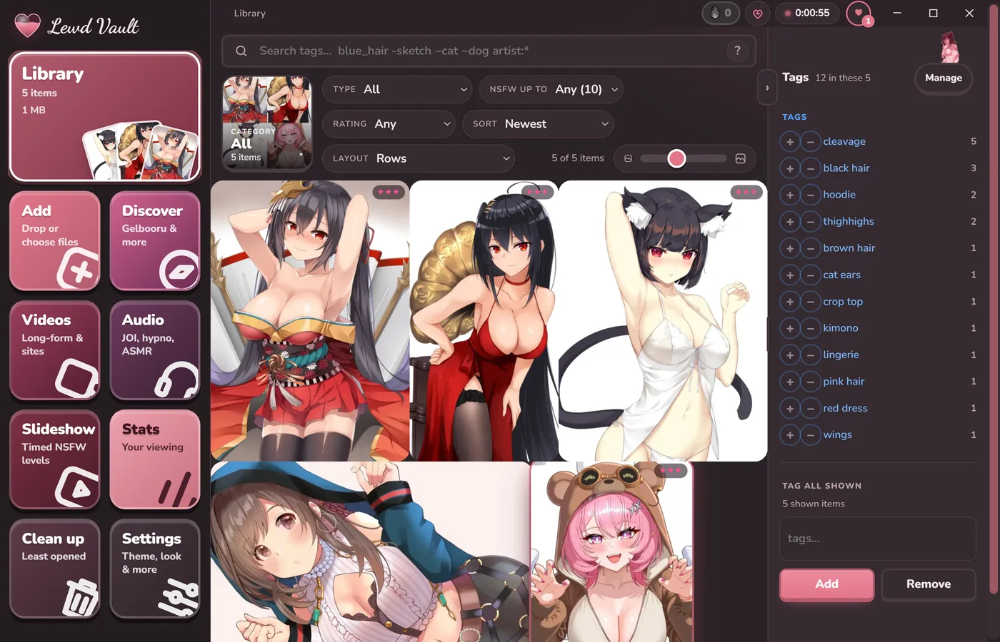
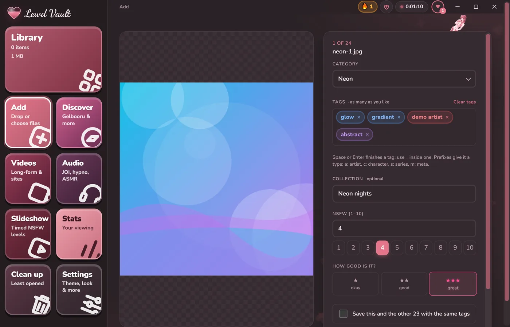
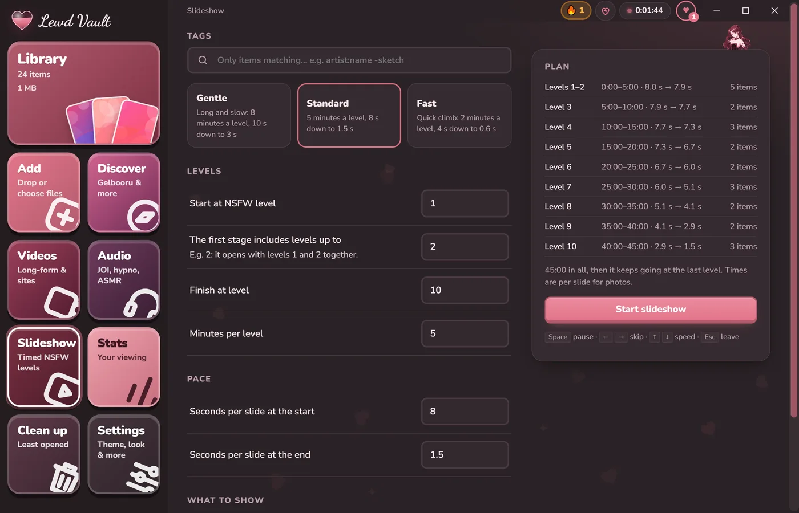
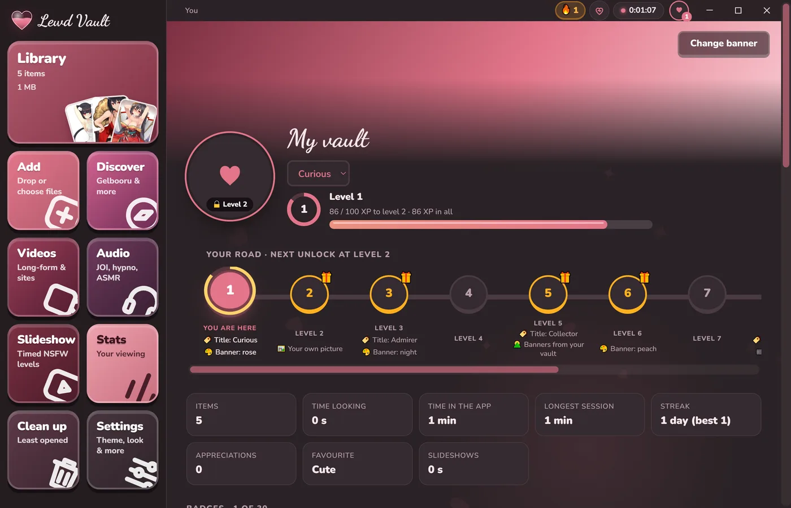
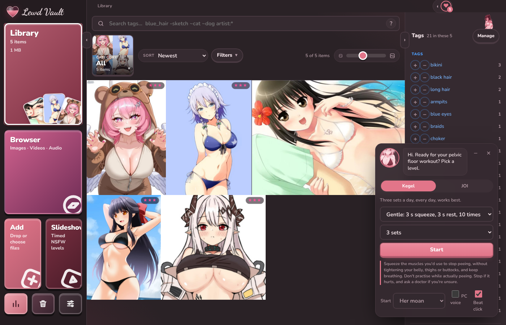
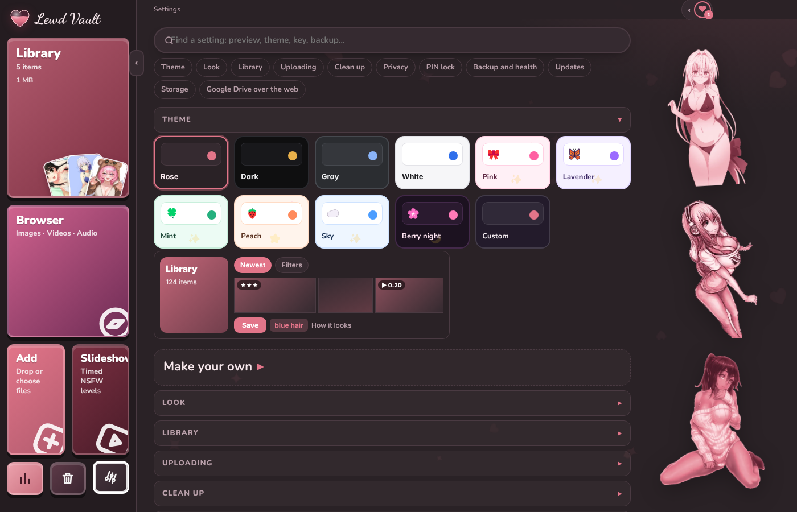
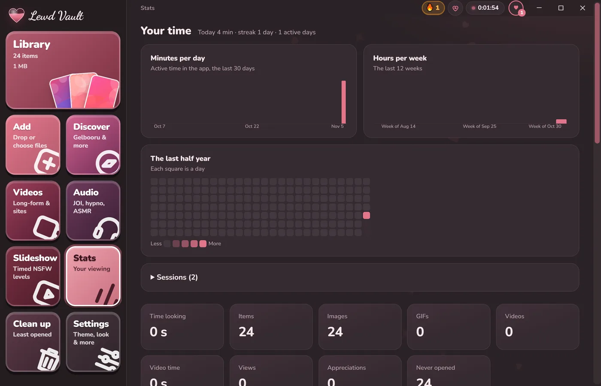

# 💖 Lewd Vault

**Your spicy collection, beautifully organised, 100% private, and all yours.** 🔒✨

Lewd Vault is a cute, fast Windows app for collecting, tagging and enjoying your NSFW pictures, GIFs, videos and audio. No accounts, no cloud you didn't pick, no judgement. 😏 *18+ only.*



## ✨ Why you'll love it

- 🧘 **Calm by default.** The everyday stuff is big and up front; extra options fold away next to where you use them and remember how you left them.
- 🗂️ **A Library that just works.** Big, buttery-smooth grid with preview clips, collections, ratings and a "For you" order.
- 🏷️ **Booru-style tags.** `artist:`, `character:`, `series:`… with suggestions and lightning-fast tag search.
- 🔍 **Browser.** One big tile for 🖼️ Images, 🎬 Videos and 🎧 Audio. Browse your favourite sites in browser-style tabs right inside the app, resize the tiles, and save with one click. You can even add your own sites!
- 🎞️ **Slideshow.** Timed NSFW-level stages that build up, with motion effects and true full screen. 🔥
- 🎬 **A real video player.** Smooth seeking, A–B loop, speed control, frame-by-frame stepping and keyboard shortcuts.
- 🕵️ **Privacy first.** Discreet file names, a **PIN lock**, plus an **emergency key** that hides everything instantly. 🙈
- ✅ **Tidy in bulk.** Ctrl/Shift-click to select many tiles and re-rate, re-tag or move them all at once; find duplicates *and* look-alikes (resized or re-saved copies).
- ⬇️ **One downloads panel** for everything you save, with retry, plus a status dot on every site tab.
- 🛟 **Backups, health checks and updates** from Settings: copy your vault to a drive (only what changed), fix broken previews, and update the app in one click.
- 🏆 **Level up!** Earn XP, unlock titles and badges, keep a streak and see your stats.
- 💪 **Your coach.** Guided Kegel workouts and JOI sessions with a cute companion.
- 🎁 **Share packs.** Bundle a collection into one `.zip` with a pretty preview card, and open packs from friends.
- 🎨 **Themes galore.** Rose, Berry night, Lavender, Mint… or design your own.
- 💾 **Your files, your disk.** One tiny ~6 MB portable `.exe`. Keep your vault on your PC, a USB stick, or a synced Google Drive, OneDrive, Dropbox or iCloud folder.

## 📸 Take a peek

| ➕ Add & tag | 🎞️ Slideshow |
| --- | --- |
|  |  |
| 🏆 **Your profile & levels** | 💪 **The coach** |
|  |  |
| 🎨 **Themes & settings** | 📊 **Stats** |
|  |  |

<sub>Screenshots show a demo vault. Artwork is used with permission of its creators.</sub>

## 🚀 Get started

1. 🛠️ Build it (see below).
2. 🖱️ Double-click `dist\Image Vault\Lewd Vault.exe`.
3. 📁 Pick where your vault should live, and start adding! 🎉

You need WebView2, which Windows 10 and 11 already have. 👍

## 🧑‍💻 Build it yourself

```bash
npm install
npm run dist
```

You need Node.js, Rust and the [Tauri prerequisites](https://tauri.app/start/prerequisites/). 📖 Want every detail? The full guide is in [docs/GUIDE.md](docs/GUIDE.md).

---

Made with 💕 and a little bit of mischief.
