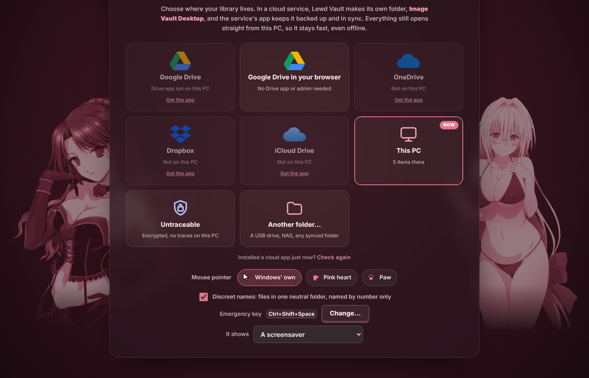
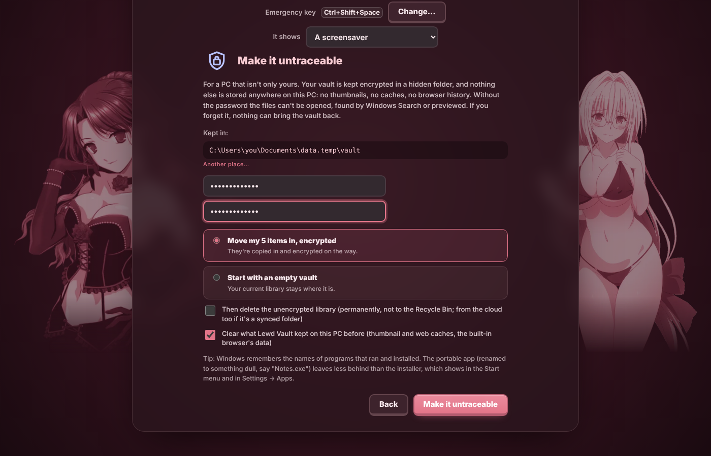
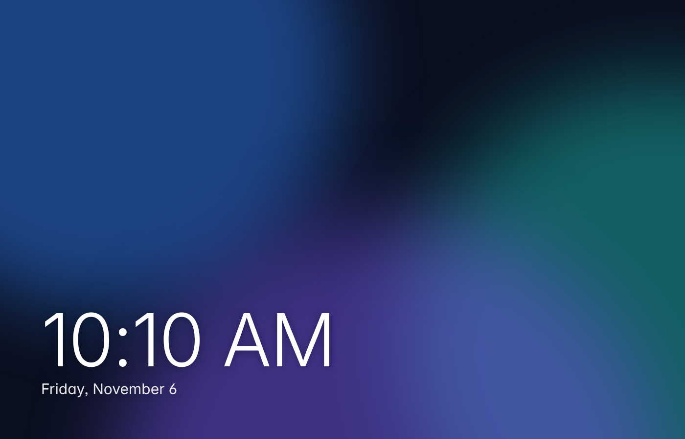
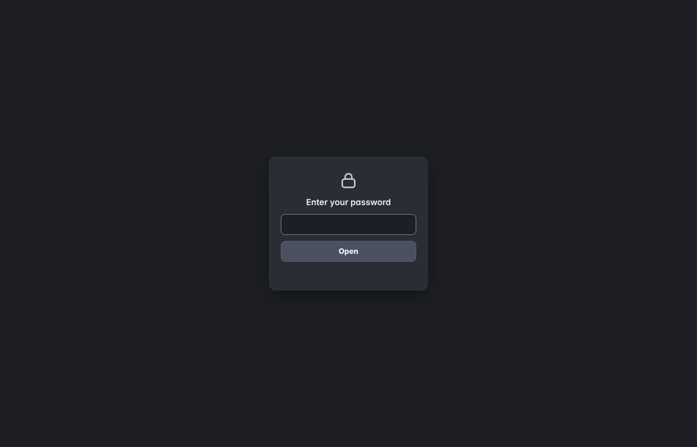

# 💖 Lewd Vault

**Your spicy collection, beautifully organised, 100% private, and all yours.** 🔒✨

Lewd Vault is a cute, fast Windows app for collecting, tagging and enjoying your NSFW pictures, GIFs, videos and audio. No accounts, no cloud you didn't pick, no judgement. 😏 *18+ only.*


## ✨ Why you'll love it

- 🧘 **Calm by default.** The everyday stuff is big and up front; extra options fold away next to where you use them and remember how you left them.
- 🗂️ **A Library that just works.** Big, buttery-smooth grid with preview clips, collections, ratings and a "For you" order.
- 🏷️ **Booru-style tags.** `artist:`, `character:`, `series:`… with suggestions and lightning-fast tag search.
- 🔍 **Browser.** One big tile for 🖼️ Images, 🎬 Videos and 🎧 Audio. Browse your favourite sites in browser-style tabs right inside the app, resize the tiles, and save with one click. You can even add your own sites!
- 🎞️ **Slideshow.** Timed NSFW-level stages that build up, with motion effects and true full screen. 🔥
- 🎬 **A real video player.** Smooth seeking, A–B loop, speed control, frame-by-frame stepping and keyboard shortcuts.
- 🕵️ **Privacy first.** Discreet file names, a **PIN lock**, plus an **emergency key** that instantly turns the app into a screensaver or a cat video. 🙈🐱
- 🥷 **Untraceable mode.** On a work laptop? Your whole vault stays encrypted in a hidden folder behind a password: next to the app, in Documents, or anywhere you pick. No thumbnails, caches or browser history anywhere else on the PC, and a plain "Notes" window on the taskbar. 🔐
- ☁️ **Google Drive, even without the Drive app.** No admin rights? Sign in once in your browser and your vault syncs both ways with your Drive (encrypted there too, in Untraceable mode). Google Drive for desktop, OneDrive, Dropbox and iCloud folders still work as before.
- ✅ **Tidy in bulk.** Ctrl/Shift-click to select many tiles and re-rate, re-tag or move them all at once; find duplicates *and* look-alikes (resized or re-saved copies).
- ⬇️ **One downloads panel** for everything you save, with retry, plus a status dot on every site tab.
- 🛟 **Backups, health checks and updates** from Settings: copy your vault to a drive (only what changed), fix broken previews, and update the app in one click.
- 🏆 **Level up!** Earn XP, unlock titles and badges, keep a streak and see your stats.
- 💪 **Your coach.** Guided Kegel workouts and JOI sessions with a cute companion.
- 🎁 **Share packs.** Bundle a collection into one `.zip` with a pretty preview card, and open packs from friends.
- 🎨 **Themes galore.** Rose, Berry night, Lavender, Mint… or design your own.
- 💾 **Your files, your disk.** One tiny ~6 MB portable `.exe` (or an installer). Keep your vault on your PC, a USB stick, or a synced Google Drive, OneDrive, Dropbox or iCloud folder. No Drive app (it needs admin)? Sign in to Google Drive in your browser and sync straight from the app.

## 📸 Take a peek

| ➕ Add & tag | 🎞️ Slideshow |
| --- | --- |
|  |  |
| 🏆 **Your profile & levels** | 💪 **The coach** |
|  |  |
| 🎨 **Themes & settings** | 📊 **Stats** |
|  |  |
| 🧭 **Pick where it lives** | 🥷 **Untraceable mode** |
|  |  |
| 🙈 **The emergency key** (a screensaver, or a cat video) | 🔒 **Untraceable's password screen** |
|  |  |

<sub>Screenshots show a demo vault. Artwork is used with permission of its creators.</sub>

## 🚀 Get started

Grab **[Lewd Vault 1.0](https://github.com/Mousyexp/Lewd-Vault/releases/latest)** from Releases:

- 💿 **Lewd.Vault.msi**: the installer. Start menu entry, uninstall from Windows Settings.
- 🎒 **Lewd.Vault.Portable.zip**: unzip anywhere (a USB stick works too) and run `Lewd Vault.exe`.

Then pick where your vault should live (your PC, a cloud folder, Google Drive in your browser, or 🥷 Untraceable), and start adding! 🎉 Both versions can do everything, Untraceable included, and both update themselves from Settings → Updates.

🥷 **Most discreet:** the portable zip, renamed to something dull (say `Notes.exe`). The installer shows up in the Start menu and in Settings → Apps; the portable app leaves no install behind and keeps the encrypted vault right next to itself.

You need WebView2, which Windows 10 and 11 already have. 👍

## 🧑‍💻 Build it yourself

```bash
npm install
npm run dist
```

You need Node.js, Rust and the [Tauri prerequisites](https://tauri.app/start/prerequisites/). 📖 Want every detail? The full guide is in [docs/GUIDE.md](docs/GUIDE.md).

---

Made with 💕 and a little bit of mischief.
